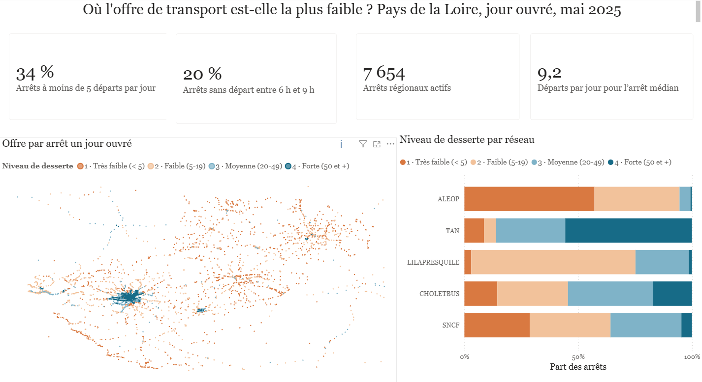
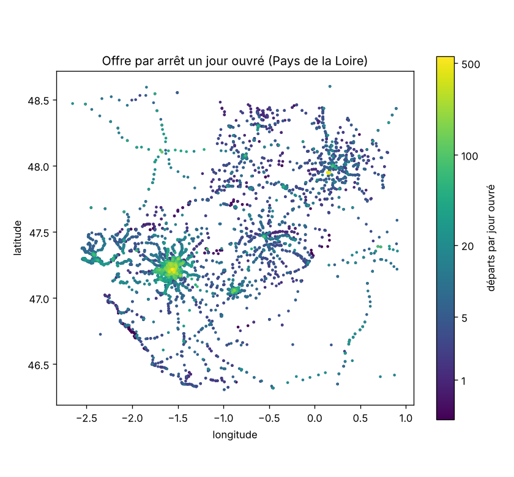
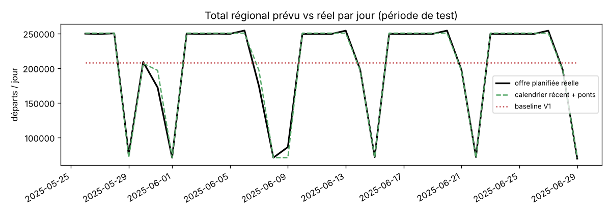
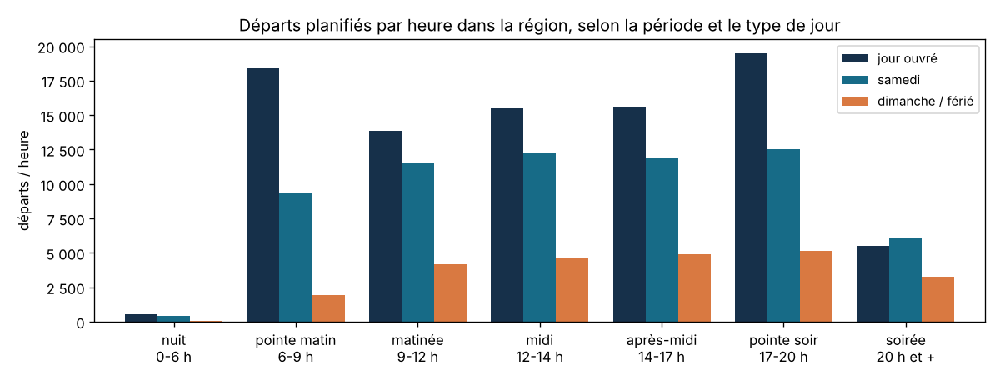

# Où l'offre de transport collectif est-elle la plus faible en Pays de la Loire ?

Projet final de la formation *Concepteur Développeur en IA et Analyse Big Data* (Wild Code School, groupe
Simplon), réalisé par **Patrick MWANIA MAZEMBE**.

À partir des horaires publiés au format GTFS par DESTINEO (4 millions de passages, 20 170 arrêts, 1 029
lignes), le projet répond à deux questions :

1. **Quels arrêts et quels créneaux sont les moins bien desservis ?**
2. **Peut-on prévoir l'offre attendue par arrêt, jour et période horaire ?**

Il s'agit de l'offre **planifiée** : le projet ne mesure ni la fréquentation, ni les retards.

## Résultats clés

- **Un tiers des arrêts sont très peu desservis.** Un jour ouvré, **34 % des 7 654 arrêts régionaux** ont
  moins de 5 départs et **20 %** n'en ont aucun entre 6 h et 9 h. C'est surtout le cas du réseau
  interurbain ALEOP (médiane : 4 départs par jour, contre 51 pour la TAN à Nantes).
- **L'offre dépend fortement du type de jour.** 258 555 départs un jour ouvré, **−27 %** le samedi et
  **−73 %** le dimanche, avec deux pointes en semaine (6 h-9 h et 17 h-20 h).
- **Une prévision simple et bien calée bat le machine learning.** Un profil calendaire récent, ajusté pour
  les ponts, prévoit l'offre avec une **MAE de 0,115 départ** sur 1,9 million d'observations de test :
  erreur divisée par 11 par rapport à la première version, et près de 4 fois plus faible qu’avec le gradient boosting.
- **Un audit qui a changé les conclusions.** Le calendrier du feed court jusqu'en 2027, mais l'offre n'est
  complète que d'avril à juin 2025. La première évaluation portait sur des dates presque vides
  (588 observations, toutes égales à 1) : la méthode a été entièrement revue
  ([révision méthodologique](docs/09_revision_methodologique.md)).

### Tableau de bord Power BI



Fichier : [reports/DASHBOARD.pbix](reports/DASHBOARD.pbix), construit à partir des tables de `reports/powerbi/`
([guide](docs/11_guide_power_bi.md)).

### Figures de l'analyse

| Offre par arrêt un jour ouvré | Prévision et offre réelle (5 semaines de test) |
|---|---|
|  |  |



## Démarche

| Étape | Ce qui a été fait | Livrable |
|---|---|---|
| 1. Cadrage et diagnostic | Question métier, indicateur, contrôle qualité des fichiers GTFS | [docs/01](docs/01_cadrage_diagnostic.md) |
| 2. Base de données | Nettoyage en SQL, base SQLite normalisée (clés, contraintes, vues), 0 orphelin | [schéma](docs/03_schema_relationnel.md), [SQL](sql/03_schema_gtfs.sql) |
| 3. API | API REST FastAPI : CRUD des arrêts, référentiels, indicateurs, tests automatisés | [docs/04](docs/04_api.md), [api/](api/main.py) |
| 4. Analyse exploratoire | Hypothèses sur l'offre par période, type de jour et nombre de lignes | [docs/07](docs/07_analyse_exploratoire_et_veille.md) |
| 5-6. Première prévision | Baseline, Random Forest, gradient boosting (évaluation remplacée à l'étape 7) | [parcours détaillé](docs/00_parcours_detaille.md) |
| **7. Révision méthodologique** | Fenêtre de service valide, grille complète avec les créneaux à 0, périmètre régional, jours fériés et ponts, 5 méthodes comparées | [docs/09](docs/09_revision_methodologique.md), [script](src/08_offre_fenetre_valide.py) |
| Restitution | Tableau de bord Power BI et présentation de 9 diapositives générée à partir des résultats | [tableau de bord](reports/DASHBOARD.pbix), [présentation](reports/presentation_analyse_mobilite.pptx) |

**Outils** : Python (pandas, scikit-learn, matplotlib), SQL / SQLite, FastAPI et Pydantic, pytest,
Power BI (DAX), python-pptx.

## Données

Export GTFS « Arrêts, horaires et circuits des lignes de transports en commun en Pays de la Loire
(DESTINEO, réseaux AOM et ALEOP) », publié sur
[data.gouv.fr](https://www.data.gouv.fr/datasets/arrets-horaires-et-circuits-des-lignes-de-transports-en-commun-en-pays-de-la-loire-gtfs-destineo-reseaux-aom-aleop-1)
(feed utilisé : version 15637). Les fichiers volumineux (`stop_times.txt`, `shapes.txt`) ne sont pas
versionnés : les télécharger et les placer dans `data/raw/gtfs/`.

## Lancer le projet

```bash
python -m venv mon_env
mon_env\Scripts\activate                 # Windows (macOS / Linux : source mon_env/bin/activate)
pip install -r requirements.txt

python src/08_offre_fenetre_valide.py    # analyse et prévision de référence (lit directement le GTFS)
python generer_presentation.py           # régénère la présentation
pytest tests -q                          # 20 tests
```

La chaîne complète (diagnostic, base SQLite, API) et les commandes détaillées sont dans le
[guide d'exécution](docs/10_guide_execution.md).

## Structure

```text
src/        scripts numérotés de la chaîne (01 → 08)
sql/        schéma relationnel et requêtes de validation
api/        API FastAPI
tests/      tests de l'API et des étapes 6 et 7
reports/    résultats (JSON, CSV), graphiques, présentation
docs/       documentation par étape, parcours détaillé, guide d'exécution
```

## Limites

- Offre **planifiée** sur 12 semaines du printemps 2025 : ni fréquentation, ni retards, ni suppressions.
- Les réseaux urbains d'Angers, Laval, Saint-Nazaire et La Roche-sur-Yon sont absents de l'export
  (6 agences déclarées sans aucune ligne).
- Un indicateur de faible offre ne mesure pas le besoin : il faudrait le croiser avec la population
  desservie avant tout arbitrage de desserte.
