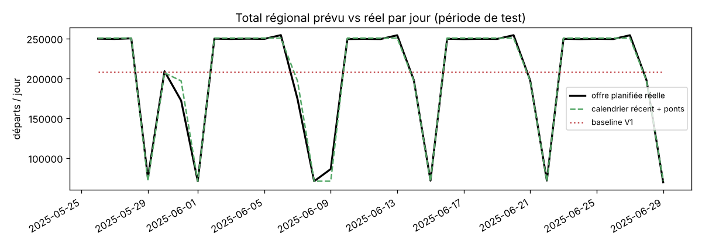
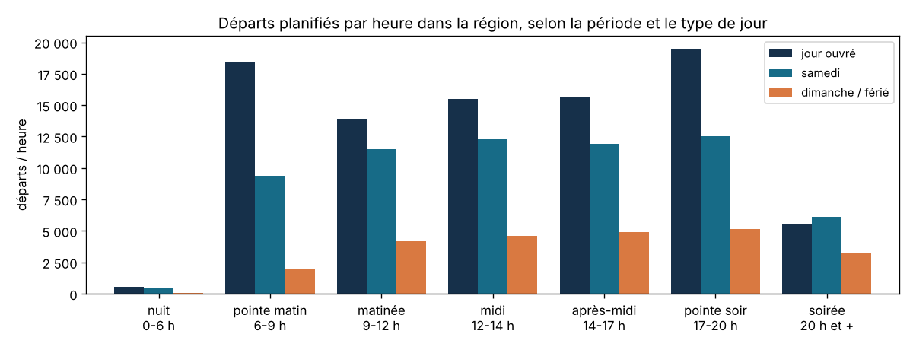
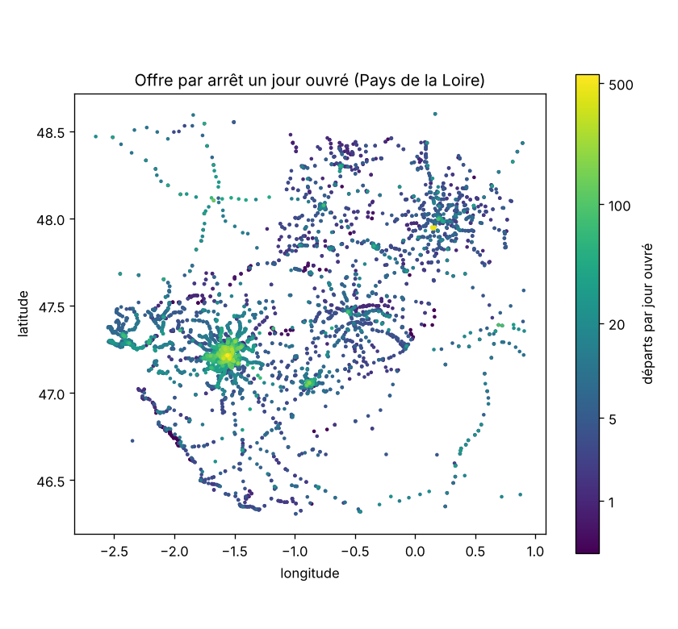

# Étape 7 : révision méthodologique de l'analyse et de la prévision de l'offre

Script : [`src/08_offre_fenetre_valide.py`](../src/08_offre_fenetre_valide.py) · Résultats :
[`reports/etape7_offre_fenetre_valide.json`](../reports/etape7_offre_fenetre_valide.json) · Tests :
[`tests/test_offre_fenetre_valide.py`](../tests/test_offre_fenetre_valide.py)

## 1. Ce que l'audit des étapes 5 et 6 a révélé

| # | Constat | Conséquence sur la version précédente |
|---|---|---|
| 1 | `calendar_dates.txt` couvre avril 2025 → avril 2027, mais l'offre n'est complète que du **2 avril au 30 juin 2025** (≈ 328 000 départs par jour ouvré). Elle tombe ensuite à quelques milliers de départs par jour en juillet, puis à **2 départs par jour** en 2026. | Le découpage 80/20 sur toutes les dates plaçait le test (nov. 2026 → avr. 2027) dans la partie vide : **588 observations, toutes égales à 1 départ**. MAE et R² ne mesuraient rien. |
| 2 | La vue `v_departures_by_stop_period` ne contient que les créneaux ayant **au moins un départ**. | Les créneaux sans service, les plus mal desservis, étaient invisibles ; la « plus faible offre » trouvée valait toujours 1. Dans la grille complète, **50 %** des créneaux arrêt × date × période n'ont aucun départ. |
| 3 | **4 434 gares SNCF hors Pays de la Loire** (jusqu'en Allemagne) ont des horaires dans le feed et représentent **24 %** des départs. | L'« offre régionale » mélangeait le réseau ferré national. |
| 4 | **406 377 passages** ont `pickup_type = 1` (pas de montée possible, souvent le terminus). | Ils étaient comptés comme des départs. La vue SQL et l'API les excluent désormais (relancer `03_charger_bdd_gtfs.py`). |
| 5 | 6 des 14 agences du feed n'ont **aucune ligne** : IRIGO (Angers), TUL (Laval), STRAN/CARENE (Saint-Nazaire), IMPULSYON (La Roche-sur-Yon), AGGLOBUS, Aéroport. | Les réseaux urbains d'Angers, Laval et Saint-Nazaire ne sont pas analysables avec cet export. |

Autres anomalies relevées : le 30 avril 2025, l'offre de la TAN est anormalement élevée (≈ 372 000 passages
contre 212 000 un mercredi normal), sans doute des services dupliqués ; à partir du 12 mai, la TAN passe à
un niveau inférieur (≈ 193 000, le même que pendant les vacances de printemps).

## 2. Méthode corrigée

- **Fenêtre** : 12 semaines complètes, du lundi 7 avril au dimanche 29 juin 2025.
- **Périmètre** : 7 654 arrêts actifs situés dans l'emprise des Pays de la Loire.
- **Départ** = passage avec montée possible (`pickup_type ≠ 1`), compté par arrêt, date et période horaire.
- **Grille complète** : 7 654 arrêts × 84 jours × 7 périodes = 4,5 millions d'observations, avec 0 quand
  aucun départ n'est prévu.
- **Calendrier** : jours fériés (traités comme des dimanches), ponts (2, 9 et 30 mai), vacances de
  printemps zone B.
- **Découpage temporel** : entraînement du 7 avril au 25 mai (7 semaines), test du 26 mai au 29 juin
  (5 semaines, avec l'Ascension, son pont et le lundi de Pentecôte).

## 3. Résultats de la prévision (1,9 million d'observations de test)

| Méthode | MAE | RMSE | MAE jours fériés / ponts | MAE jours normaux |
|---|---|---|---|---|
| Baseline V1 : moyenne par arrêt × période | 1,272 | 3,173 | 1,910 | 1,213 |
| Calendrier : moyenne par arrêt × type de jour × période | 0,388 | 1,238 | 0,641 | 0,364 |
| Calendrier récent (2 dernières semaines) | 0,124 | 0,741 | 0,455 | 0,093 |
| **Calendrier récent + ajustement des ponts** | **0,115** | **0,672** | **0,357** | **0,093** |
| Gradient boosting (perte de Poisson) | 0,438 | 1,788 | 0,753 | 0,408 |

**Lecture.** L'offre planifiée est très régulière : la meilleure prévision est le **profil des deux
dernières semaines par type de jour**, corrigé pour les ponts. Elle divise l'erreur par 11 par rapport à
la baseline V1. Le gradient boosting fait moins bien, parce qu'il apprend sur des semaines antérieures au
changement d'offre de la TAN à la mi-mai. Un modèle d'apprentissage n'apporte donc rien ici : ce qui
compte, c'est de bien représenter le calendrier et de repérer les ruptures d'offre.

## 4. Profil de l'offre par heure et type de jour

Jours normaux de la fenêtre (hors fériés, ponts et vacances), grille complète, périmètre régional :

- **258 555 départs par jour ouvré**, 187 641 le samedi (**−27 %**) et 70 860 le dimanche ou un jour férié
  (**−73 %**).
- Deux pointes en semaine : 18 386 départs par heure de 6 h à 9 h et 19 521 de 17 h à 20 h, contre 5 523 après
  20 h. Le samedi, la pointe du matin est divisée par deux.

Ces chiffres remplacent les hypothèses H1 et H2 de l'étape 4, calculées sur tout le calendrier du feed et
sans les créneaux à 0.

## 5. Faible desserte (jour ouvré normal, semaines du 12 au 23 mai)

- Médiane : **9,2 départs par jour** et par arrêt.
- **33,7 %** des arrêts ont moins de 5 départs par jour ; **19,5 %** n'ont aucun départ entre 6 h et 9 h.
- C'est surtout le réseau interurbain **ALEOP** : 3 785 arrêts, médiane de 4 départs par jour, 57 %
  sous 5 départs, 31 % sans départ en pointe du matin. À l'opposé, la **TAN** (Nantes) a une médiane de
  51 départs par jour.

Le détail par arrêt (nom, coordonnées, départs par jour, départs en pointe du matin) est dans
[`reports/etape7_offre_par_arret.csv`](../reports/etape7_offre_par_arret.csv).

## 6. Limites

- Offre **planifiée** sur 3 mois du printemps 2025 : ni fréquentation, ni retards, ni suppressions.
- Réseaux urbains d'Angers, Laval, Saint-Nazaire et La Roche-sur-Yon absents de l'export.
- Le comptage par arrêt dépend du découpage des arrêts physiques (quais) propre à chaque réseau.
